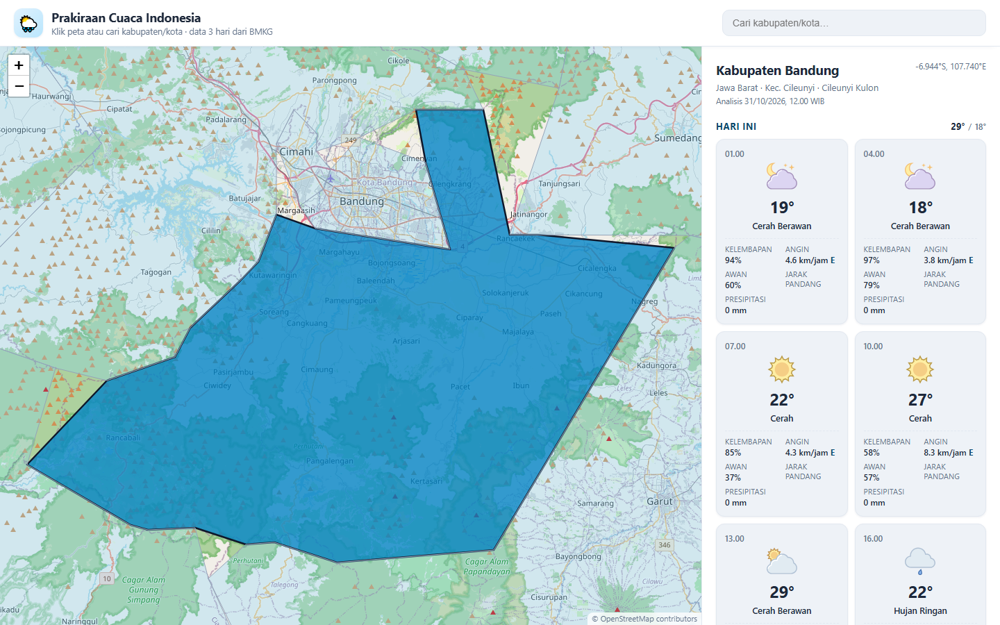
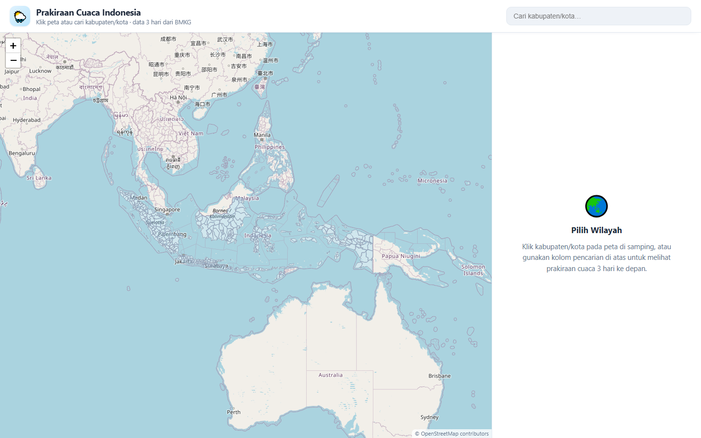
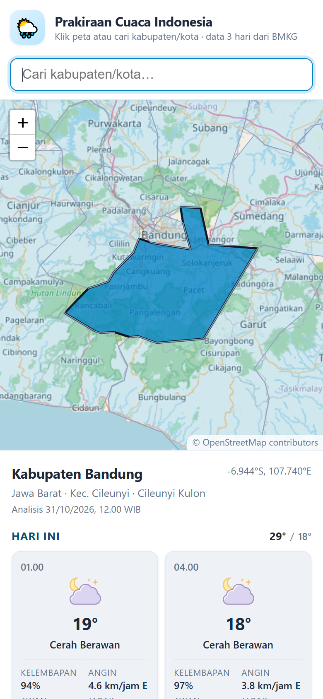
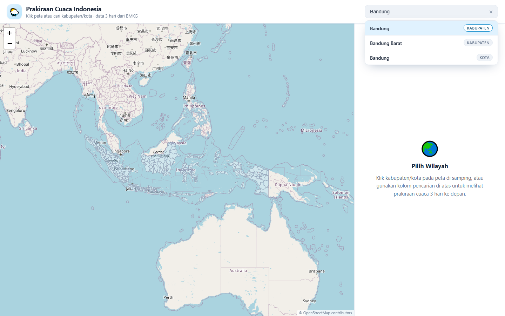
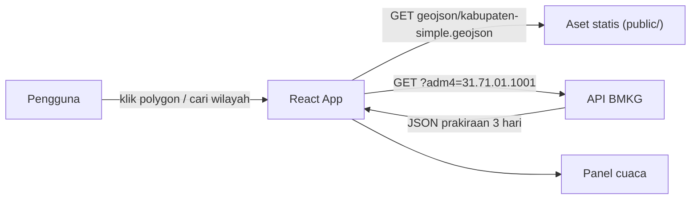

# Prakiraan Cuaca Indonesia — Peta Interaktif


Aplikasi web untuk melihat **prakiraan cuaca 3 hari ke depan** untuk **seluruh kabupaten/kota di Indonesia** (514 wilayah, 38 provinsi). Wilayah dipilih langsung lewat **peta interaktif** berbasis Leaflet, atau melalui kolom pencarian. Data diambil langsung dari [API data terbuka BMKG](https://data.bmkg.go.id/prakiraan-cuaca).

> **Demo live:** https://mikhaells.github.io/Prakiraan-Cuaca-Indonesia----BMKG/
>
> **Repositori:** https://github.com/Mikhaells/Prakiraan-Cuaca-Indonesia----BMKG

---

## Daftar Isi

- [Tampilan Aplikasi](#tampilan-aplikasi)
- [Fitur](#fitur)
- [Teknologi](#teknologi)
- [Arsitektur & Alur Data](#arsitektur--alur-data)
- [Struktur Project](#struktur-project)
- [Menjalankan di Lokal](#menjalankan-di-lokal)
- [Konfigurasi](#konfigurasi)
- [Scripts](#scripts)
- [Cara Kerja Data](#cara-kerja-data)
- [Deploy ke GitHub Pages](#deploy-ke-github-pages)
- [Regenerasi Data](#regenerasi-data)
- [Troubleshooting](#troubleshooting)
- [Aksesibilitas & Performa](#aksesibilitas--performa)
- [Atribusi & Lisensi](#atribusi--lisensi)
- [Kontribusi](#kontribusi)

---

## Tampilan Aplikasi

<p align="center">
  
  <br />
  <em>Desktop — panel prakiraan 3 hari setelah memilih Kabupaten Bandung.</em>
</p>

<table>
  <tr>
    <td width="50%" align="center">
      
      <br />
      <em>Tampilan awal — peta 514 kabupaten/kota.</em>
    </td>
    <td width="50%" align="center">
      
      <br />
      <em>Mobile — peta di atas, panel detail di bawah.</em>
    </td>
  </tr>
  <tr>
    <td colspan="2" align="center">
      
      <br />
      <em>Pencarian wilayah — mendukung navigasi keyboard (↑ ↓ Enter Esc).</em>
    </td>
  </tr>
</table>

---

## Fitur

### Peta interaktif
- Polygon **514 kabupaten/kota** dari GeoJSON yang sudah disederhanakan, tetap tajam saat di-zoom.
- **Klik wilayah** untuk memilih dan memuat prakiraan cuacanya.
- Hover menampilkan **tooltip nama wilayah** dan menyorot polygon.
- Wilayah terpilih diberi gaya berbeda, lalu peta otomatis **fly-to** ke wilayah tersebut.
- Peta otomatis menyesuaikan ukuran saat jendela di-resize atau orientasi perangkat berubah.

### Pencarian
- Cari berdasarkan **nama kabupaten/kota** (mis. “Bandung”, “Jakarta”, “Jayapura”).
- Pencarian **tidak peka huruf besar/kecil dan diakritik**.
- Navigasi keyboard: `↑` / `↓` untuk memilih, `Enter` untuk membuka, `Esc` untuk menutup.
- Maksimal 12 hasil, dengan label jenis wilayah (Kabupaten/Kota).
- Tombol **bersihkan** pencarian dan state “Tidak ditemukan”.

### Panel cuaca
- Prakiraan **3 hari** ke depan, dikelompokkan per hari: **Hari Ini / Besok / Lusa**.
- Kartu per **periode 3 jam** berisi:
  - suhu (°C), deskripsi cuaca, dan ikon resmi BMKG;
  - kelembapan, kecepatan & arah angin, tutupan awan, jarak pandang, presipitasi;
  - penanda **“Sekarang”** untuk periode yang sedang berjalan.
- Ringkasan **suhu maksimum/minimum** per hari.
- Menampilkan provinsi, kecamatan/desa referensi, koordinat, dan waktu **analisis BMKG (WIB)**.
- Empat state lengkap: **loading**, **kosong (ajakan memilih wilayah)**, **error + tombol Coba Lagi**, dan **sukses**.

### Lainnya
- Ikon cuaca BMKG dengan **fallback teks** bila gambar gagal dimuat.
- Basemap **OpenStreetMap** secara default (keyless, tanpa watermark); **CARTO Voyager** opsional lewat API key.
- Atribusi BMKG, OpenStreetMap, dan CARTO ditampilkan sesuai ketentuan.
- Layout responsif: desktop dua kolom, mobile satu kolom, dan mode landscape pendek.
- Mendukung `prefers-reduced-motion`, `safe-area-inset`, dan `100svh` untuk browser mobile.

---

## Teknologi

| Lapisan | Teknologi | Keterangan |
| --- | --- | --- |
| UI | [React 19](https://react.dev) | Komponen fungsi + hooks |
| Build | [Vite 8](https://vite.dev) | Dev server & bundling |
| Peta | [Leaflet 1.9](https://leafletjs.com) + [react-leaflet 5](https://react-leaflet.js.org) | Polygon GeoJSON, tile layer, tooltip |
| Data cuaca | [API BMKG](https://data.bmkg.go.id/prakiraan-cuaca) | `GET /publik/prakiraan-cuaca?adm4={kode}` |
| Data wilayah | GeoJSON + JSON statis | Disajikan dari `public/` dan `src/data/` |
| Lint | [oxlint](https://oxc.rs/docs/guide/usage/linter) | `npm run lint` |
| Deploy | [gh-pages](https://github.com/tschaub/gh-pages) | Build → branch `gh-pages` |

---

## Arsitektur & Alur Data



Aplikasi ini **sepenuhnya client-side** — tidak ada backend/server sendiri:

1. Saat dibuka, aplikasi memuat GeoJSON polygon dari `public/geojson/` dan merender peta Indonesia.
2. Klik polygon (atau pilih hasil pencarian) menghasilkan kode wilayah `adm2`.
3. Kode `adm2` dipetakan ke kode desa `adm4` melalui `src/data/kabupatenAdm4.json`.
4. Browser memanggil API BMKG dengan `adm4` tersebut.
5. Respons JSON diolah menjadi kelompok hari dan kartu periode 3 jam di panel kanan.

---

## Struktur Project

```text
.
├─ public/
│  ├─ favicon.svg
│  └─ geojson/
│     └─ kabupaten-simple.geojson     # 514 polygon kabupaten/kota
├─ scripts/
│  ├─ generate-adm4.js                # regenerasi pemetaan adm2 → adm4
│  └─ tmp/                            # cache CSV sumber + progress
├─ src/
│  ├─ components/
│  │  ├─ SearchBox.jsx                # pencarian + navigasi keyboard
│  │  ├─ WeatherCard.jsx              # kartu per periode 3 jam
│  │  ├─ WeatherMap.jsx               # Leaflet + GeoJSON
│  │  └─ WeatherPanel.jsx             # panel detail & state
│  ├─ data/
│  │  └─ kabupatenAdm4.json           # 514 kab/kota → adm4
│  ├─ lib/
│  │  └─ bmkg.js                      # fetch + helper tanggal/waktu
│  ├─ App.jsx                         # state & komposisi halaman
│  ├─ App.css                         # layout & komponen
│  ├─ index.css                       # design tokens & reset
│  └─ main.jsx                        # entry point
├─ docs/screenshots/                  # gambar untuk README
├─ index.html
├─ vite.config.js                     # base: './' agar aman di subpath
├─ package.json
└─ .env.example
```

---

## Menjalankan di Lokal

### Prasyarat

- **Node.js `^20.19.0` atau `>=22.12.0`** (syarat Vite 8).
- npm (sudah termasuk dalam instalasi Node.js).
- Git (dibutuhkan untuk deploy ke GitHub Pages).
- Koneksi internet — dibutuhkan untuk tile peta dan API BMKG.

### Instalasi

```bash
git clone https://github.com/Mikhaells/Prakiraan-Cuaca-Indonesia----BMKG.git
cd Prakiraan-Cuaca-Indonesia----BMKG
npm install
```

### Mode pengembangan

```bash
npm run dev
```

Buka URL yang ditampilkan Vite (biasanya `http://localhost:5173`).

### Build produksi

```bash
npm run build     # hasil di folder dist/
npm run preview   # menjalankan dist/ secara lokal
```

---

## Konfigurasi

Semua konfigurasi bersifat opsional. Salin contoh berikut bila perlu:

```bash
# macOS / Linux
cp .env.example .env.local

# Windows (PowerShell)
Copy-Item .env.example .env.local
```

| Variabel | Wajib | Default | Keterangan |
| --- | --- | --- | --- |
| `VITE_CARTO_API_KEY` | Tidak | _(kosong)_ | API key CARTO Basemaps. Jika kosong, aplikasi memakai tile OpenStreetMap. |

Catatan:

- Variabel `VITE_*` **ikut ter-bundle ke sisi client**, jadi nilainya bersifat publik. Batasi key per domain di dashboard CARTO.
- Tanpa key, tile CARTO akan menampilkan watermark **“API key required”** — karena itu aplikasi otomatis memilih OSM saat key kosong.
- `.env.local` **tidak boleh di-commit** (sudah masuk `.gitignore`).

---

## Scripts

| Perintah | Fungsi |
| --- | --- |
| `npm run dev` | Menjalankan dev server Vite dengan hot reload. |
| `npm run build` | Build produksi ke folder `dist/`. |
| `npm run preview` | Menyajikan hasil build `dist/` secara lokal. |
| `npm run lint` | Menjalankan oxlint pada source code. |
| `npm run deploy` | `vite build` lalu mendorong `dist/` ke branch `gh-pages`. |
| `npm run data:adm4` | Regenerasi `src/data/kabupatenAdm4.json` (memanggil API BMKG, ±10 menit). |

---

## Cara Kerja Data

### Sumber data cuaca

- Endpoint: `https://api.bmkg.go.id/publik/prakiraan-cuaca?adm4={kode}`
- Respons berisi `lokasi` (provinsi, kotkab, kecamatan, desa, lat/lon) dan `data[0].cuaca`.
- `cuaca` adalah array periode 3 jam; setiap item memuat `local_datetime`, `t`, `hu`, `ws`, `wd`, `tcc`, `vs_text`, `tp`, `weather_desc`, dan `image`.
- Aplikasi **tidak menyimpan cache** data cuaca; setiap wilayah yang dipilih akan di-fetch ulang agar data selalu segar.

### Pemetaan wilayah (`adm2` → `adm4`)

API BMKG hanya menerima kode level **desa/kelurahan** (`adm4`), sedangkan peta memakai kode **kabupaten/kota** (`adm2`). Karena itu:

- Setiap kabupaten/kota dipetakan ke **satu desa/kelurahan referensi**.
- Data prakiraan BMKG untuk desa tersebut mewakili wilayah kabupaten/kota secara umum.
- File `src/data/kabupatenAdm4.json` berisi **514 entri** dengan field:

```json
{
  "adm2": "32.04",
  "name": "Kabupaten Bandung",
  "regency": "Bandung",
  "provinceCode": "32",
  "adm4": "32.04.01.2001"
}
```

### Wilayah dengan kode khusus

Dua kabupaten/kota di provinsi baru **Papua Barat Daya** memakai kode lama (provinsi `92`) karena database BMKG belum memuat kode baru (`96`):

| `adm2` | `adm4` yang dipakai | Catatan |
| --- | --- | --- |
| `96.02` | `92.04.01.2004` | Kode lama (provinsi 92) sesuai database BMKG |
| `96.03` | `92.05.01.2001` | Kode lama (provinsi 92) sesuai database BMKG |

Field `note` pada kedua entri menjelaskan hal ini.

### Batasan

- Prakiraan mengikuti ketersediaan dan jadwal pembaruan BMKG (3 hari, per 3 jam).
- Data yang ditampilkan adalah prakiraan, bukan peringatan dini cuaca ekstrem.
- Aplikasi ini **bukan layanan resmi BMKG**.

---

## Deploy ke GitHub Pages

Deploy memakai branch **`gh-pages`** (tanpa GitHub Actions). Hasil build dikirim langsung oleh paket `gh-pages`.

### Pertama kali

1. **Aktifkan Pages** di GitHub: **Settings → Pages → Build and deployment**
   - **Source:** `Deploy from a branch`
   - **Branch:** `gh-pages`
   - **Folder:** `/ (root)`
   - Klik **Save**.
2. **Push source code** (lewati bila remote sudah terpasang):
   ```bash
   git init
   git add .
   git commit -m "Initial commit"
   git branch -M main
   git remote add origin https://github.com/<username>/<nama-repo>.git
   git push -u origin main
   ```
3. **Build & publish:**
   ```bash
   npm run deploy
   ```
   Perintah ini menjalankan `vite build` lalu mendorong isi `dist/` ke branch `gh-pages`.
4. Situs live di `https://<username>.github.io/<nama-repo>/`.

> Base path memakai nilai relatif (`base: './'`), jadi tidak perlu menyesuaikan nama repo.

### Update setelah ada perubahan

**Penting:** push ke `main` **tidak** mengubah situs live. Situs hanya berubah jika branch `gh-pages` diperbarui.

```bash
git add -A
git commit -m "Deskripsi perubahan"
git push origin main      # backup source (opsional, disarankan)
npm run deploy            # build + update situs live
```

Tunggu **1–2 menit** untuk propagasi CDN GitHub Pages, lalu hard refresh (`Ctrl+Shift+R`).

### Verifikasi deploy

Cek hash aset di HTML live — nilainya harus berubah setelah deploy baru:

```bash
# macOS / Linux
curl -s https://<username>.github.io/<nama-repo>/ | grep "assets/index-"
```

```powershell
# Windows (PowerShell)
(Invoke-WebRequest https://<username>.github.io/<nama-repo>/).Content |
  Select-String "assets/index-"
```

Cek juga branch `gh-pages` sudah berisi build terbaru:

```bash
git ls-remote --heads origin
git show origin/gh-pages:index.html
```

### Catatan deploy

- Repo harus **public** (atau akun GitHub Pro) agar GitHub Pages gratis aktif.
- `npm run deploy` membutuhkan akses push ke remote; siapkan kredensial Git/GitHub.
- Jangan mengedit folder `dist/` secara manual — isinya selalu ditimpa saat build.
- Jika memakai `VITE_CARTO_API_KEY`, jalankan deploy dari mesin yang memiliki `.env.local` karena nilainya dibakar saat build.

---

## Regenerasi Data

### 1. GeoJSON kabupaten/kota

Unduh `kab_kota.geojson` dari [AlfianAliM/Indonesia-GeoJSON](https://github.com/AlfianAliM/Indonesia-GeoJSON), lalu sederhanakan agar ukurannya kecil:

```bash
npx mapshaper kab_kota.geojson -simplify 2% keep-shapes \
  -o format=geojson public/geojson/kabupaten-simple.geojson
```

Hasil akhir: **514 fitur** dengan properti `code` (= `adm2`) dan `name`.

### 2. Pemetaan `adm2` → `adm4`

```bash
npm run data:adm4
```

Skrip `scripts/generate-adm4.js`:

1. Mengunduh `regencies.csv` dan `villages.csv` dari `idn-area-data@4.0.1` via jsDelivr (di-cache di `scripts/tmp/`).
2. Mengambil kandidat desa untuk setiap kabupaten/kota (maks. 6 percobaan).
3. Memvalidasi kandidat ke API BMKG sampai menemukan kode yang mengembalikan data.
4. Menulis hasil ke `src/data/kabupatenAdm4.json` dan progres ke `scripts/tmp/adm4-progress.json`.

Perkiraan durasi **±10 menit** karena ada jeda `1,1 detik` antar-request agar tidak melewati batas **60 request/menit** dari BMKG.

---

## Troubleshooting

| Gejala | Kemungkinan penyebab | Solusi |
| --- | --- | --- |
| Situs live **404** | GitHub Pages belum aktif atau source salah | Settings → Pages → branch `gh-pages`, folder `/ (root)` |
| Perubahan tidak muncul | Belum `npm run deploy` atau cache CDN | Jalankan deploy, tunggu 1–2 menit, hard refresh |
| Favicon masih ikon lama | Browser meng-cache favicon dengan agresif | `Ctrl+Shift+R` atau buka mode incognito |
| Peta abu-abu / tile kosong | Koneksi ke tile provider terblokir | Cek internet, coba jaringan lain, pastikan tidak memblokir `tile.openstreetmap.org` |
| Panel menampilkan “Gagal mengambil data cuaca” | API BMKG sedang gangguan / rate limit | Klik **Coba Lagi**, cek status API BMKG |
| Tile menampilkan watermark “API key required” | Key CARTO kosong/tidak valid | Isi `VITE_CARTO_API_KEY`, atau kosongkan untuk memakai OSM |
| `npm run deploy` gagal autentikasi | Kredensial Git belum tersimpan | Login GitHub / atur credential manager |
| Build gagal karena versi Node | Node terlalu lama | Gunakan Node `^20.19.0` atau `>=22.12.0` |
| Pencarian wilayah tidak menemukan hasil | Nama berbeda (mis. singkatan) | Coba nama tanpa “Kabupaten/Kota”, mis. “Bandung” |
| Data wilayah kosong | Entri `adm4` bernilai `null` | Jalankan ulang `npm run data:adm4` |

---

## Aksesibilitas & Performa

**Aksesibilitas**
- Semua kontrol interaktif memakai elemen native (`button`, `input`) sehingga dapat dioperasikan keyboard.
- Pencarian mendukung `↑` `↓` `Enter` `Esc`; fokus keyboard selalu terlihat (ring `--accent`).
- Label ARIA pada input pencarian, tombol bersihkan, dan tombol retry.
- Ikon dekoratif ditandai `aria-hidden`; metrik memakai `<dl>/<dt>/<dd>`.
- Menghormati `prefers-reduced-motion` untuk mengurangi animasi.
- Kontras teks mengikuti token warna (`--text` / `--text-muted`) yang aman di latar putih.

**Performa**
- Tidak ada backend; semua data diambil langsung dari API publik.
- GeoJSON disederhanakan (~0,55 MB) agar peta cepat dimuat.
- Ikon cuaca memakai `loading="lazy"`.
- Peta memakai `ResizeObserver` dan `invalidateSize()` agar tetap responsif tanpa render berlebih.
- Bundle produksi saat ini sekitar **412 KB JS (≈117 KB gzip)** dan **26 KB CSS (≈9 KB gzip)**.

---

## Atribusi & Lisensi

### Data & aset

| Sumber | Penggunaan | Ketentuan |
| --- | --- | --- |
| [BMKG](https://data.bmkg.go.id) | Data prakiraan cuaca & ikon cuaca | Wajib mencantumkan atribusi BMKG |
| [OpenStreetMap](https://www.openstreetmap.org/copyright) | Basemap default | © OpenStreetMap contributors, ODbL |
| [CARTO](https://carto.com/attributions) | Basemap opsional (Voyager) | Sesuai ketentuan CARTO |
| [Indonesia-GeoJSON](https://github.com/AlfianAliM/Indonesia-GeoJSON) | Batas administrasi kabupaten/kota | Data terbuka (Kepmendagri) yang dimuat ulang komunitas |

Atribusi BMKG ditampilkan di panel cuaca dan wajib dipertahankan. Data prakiraan cuaca © **BMKG (Badan Meteorologi, Klimatologi, dan Geofisika)**.

### Lisensi kode

Repositori ini **belum menyertakan file `LICENSE`**. Jika ingin merilisnya sebagai proyek open source, tambahkan lisensi pilihan Anda (misalnya MIT) melalui file `LICENSE` di root repo.

> **Disclaimer:** aplikasi ini bukan layanan resmi BMKG dan tidak menggantikan informasi resmi dari BMKG.

---

## Kontribusi

1. Fork repositori dan buat branch baru:
   ```bash
   git checkout -b fitur/nama-fitur
   ```
2. Lakukan perubahan, lalu pastikan lint bersih:
   ```bash
   npm run lint
   npm run build
   ```
3. Commit dan buka Pull Request:
   ```bash
   git commit -m "Tambah: deskripsi singkat"
   git push origin fitur/nama-fitur
   ```

Untuk perubahan UI, sertakan screenshot sebelum/sesudah agar mudah ditinjau.
